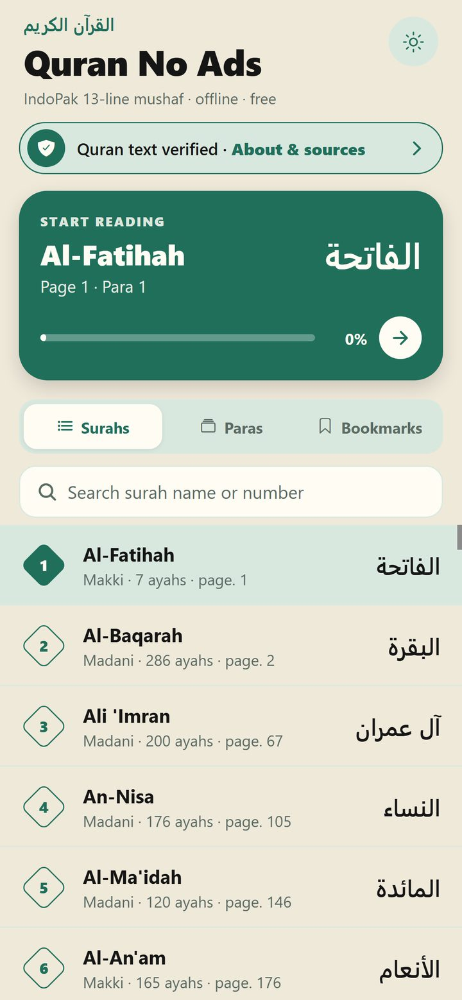
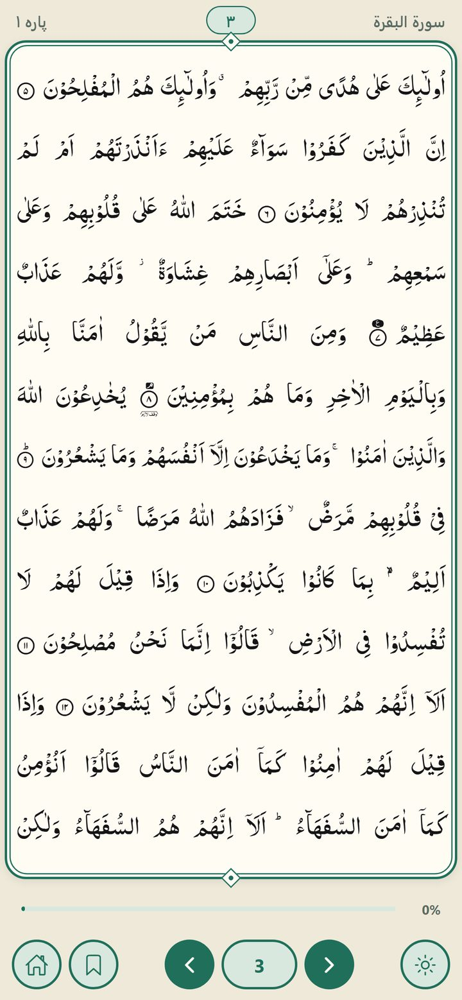
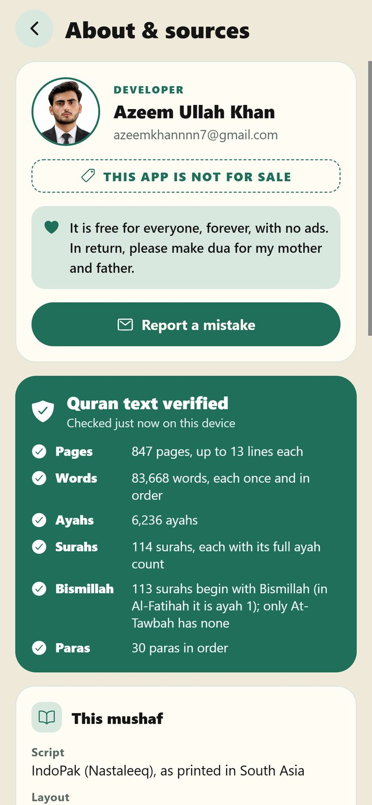

# Quran No Ads

An offline, ad-free 13-line IndoPak mushaf (Taj Company layout, 847 pages) for Android and iOS, built with Expo / React Native.

Free for everyone, with no ads and no tracking. **This app is not for sale.**

## Goal: light enough for almost every phone

Many people read the Quran on old, cheap or slow phones. Quran No Ads is built to run well on them:

- **Small download.** Pages are drawn from one font and a compact text file (about 600 KB compressed), not from 847 page images that would weigh hundreds of MB.
- **Works fully offline.** No internet permission is needed for reading, and there are no ads, no tracking and no accounts.
- **Old phones supported:** Android 7.0 or later (32-bit and 64-bit phones), and iOS 16.4 or later.
- **Light on memory.** Only the pages around the one you are reading are kept in memory (five on iPhone), and the line measuring work is done once per phone and then saved.
- **Few dependencies.** Only core Expo modules are used, and new heavy libraries are not accepted (see [CONTRIBUTING.md](CONTRIBUTING.md)).

## Download

- **Android:** download the APK from the [latest release](https://github.com/azeemkhannn/quran-no-ads/releases/latest) and open it on your phone. You may need to allow "Install unknown apps" for your browser or file manager.
- **iPhone:** not published yet. Apple requires a paid developer account to sign iPhone apps; until then you can run it with Expo Go (see [Run](#run)).

## Screenshots

| Home | Reading (13 lines) | About & sources |
|---|---|---|
|  |  |  |

## Contributing

Contributions are welcome! The most valuable help is **reporting mistakes in the Quran text or layout**: use the [Quran text mistake form](https://github.com/azeemkhannn/quran-no-ads/issues/new?template=text_mistake.yml) with the page and line number. To help with code, read [CONTRIBUTING.md](CONTRIBUTING.md) for setup, rules and good first issues. Please follow the [Code of Conduct](CODE_OF_CONDUCT.md).

## Licence

- **Code:** [GPL-3.0-or-later](LICENSE). You may use and change it, but apps built from it must stay open source under the GPL.
- **Font, Quran text and page layout:** not covered by the GPL. They belong to their authors (QuranWBW, the Quranic Universal Library by Tarteel, and Taj Company), and permission requests are in progress. See [NOTICE.md](NOTICE.md) and [docs/LICENSES.md](docs/LICENSES.md).
- **App code libraries** (Expo, React Native, …): MIT, by their authors.

## Status
- All **847 pages** render from the font plus layout data (no page images).
- Lines are justified like the print. Surah-ending lines are centered, and each surah has a header and a Bismillah line.
- One font size per device: the widest line fills the screen (on tablets the height limits it).
- Right-to-left page swipe (page 1 on the right), Next/Prev buttons and a Go-to-page box. Android and web use a FlatList of all pages; iPhone uses a small five-page pager (`src/reader/PagePager.tsx`), because the long list could open on a blank page there.
- Light, Sepia and Night themes.
- **Resume:** reopens on the last page read. The theme and bookmarks are saved on the device (SQLite key-value store on phones, `localStorage` on web), with no account and no network.
- **Home landing page** (the app opens here) has:
  - a "Continue reading" card with reading progress;
  - a **Surahs** tab with search by name or number;
  - a **Paras** tab with the traditional IndoPak para names;
  - a **Bookmarks** tab with remove buttons.
  
  Tapping anything opens the reader. The reader's home button, or Android Back, returns here. Home also measures the reader's font size in the background, so pages open instantly.
- **Your place is kept automatically, with no questions.** "Continue reading" is your main place (for example, a khatm). Opening a surah, para or bookmark from Home reads it on the side and leaves your main place where it is. Two cases do move it: when you haven't started reading yet, and when the page is right at your place. Side readings appear under **Recently read** (one entry per surah, at the page where you stopped; long-press to remove). In the reader, the line above the toolbar says "Your place stays on page N" and has a **Move here** button. When you're reading your main place, it shows your progress instead. The rules are in `readerStore.modeFor`.
- **Bookmarks:** a toolbar button toggles the bookmark on the current page, and bookmarked pages show a solid page badge.
- Navigation uses Expo Router. Routes are in `src/app/` (`/` is Home, `/read` is the reader), screens in `src/home/` and `src/reader/`, and state in `src/store/`.
- A browser check at phone width found no line overflowing on any of the 847 pages.

## Run
```
npm install
npx expo start          # press a = Android, i = iOS (Expo Go), w = web
```

## Data
`assets/data/quran.json` (2.6 MB, about 600 KB compressed) is generated from the QUL downloads:

```
python -I scripts/build_data.py <folder with unzipped QUL files> assets/data/quran.json
```

The script needs these files in the folder:
- `indopak-13-lines-taj-company.db`
- `indopak-nastaleeq.db`
- `quran-metadata-surah-name.sqlite`
- `quran-metadata-juz.sqlite`

It **fails** unless all of these hold:
- every word 1..83,668 appears exactly once, in order;
- 847 pages with at most 13 lines each;
- 6,236 ayahs, 114 surah headers, 112 separate Bismillah lines and 30 juz. Every surah except At-Tawbah begins with Bismillah; in Al-Fatihah it is ayah 1, so it isn't a separate line.

The data is bundled as compact JSON rather than SQLite because it is read-only and small. That avoids a native database dependency and works the same on Android, iOS and web.

## Files
- `src/reader/layout.ts`: font-size and line-height maths (the numbers to tune)
- `src/reader/MushafPage.tsx`: draws one page
- `src/reader/LineMeasurer.tsx`: measures the 500 longest candidate lines once per phone and saves the result
- `src/data/pages.ts`: reads `quran.json` and builds each page on demand

## Next
- Test on more real Android and iOS phones, especially small screens and low-end Android.
- Publish on Google Play and the App Store.
- Have a hafiz proofread every page against the printed Taj 13-line mushaf. One known item: QUL encodes the ayah-1 marker of Al-Fatiha's Bismillah with a different glyph (U+F61E) that shows as an empty circle.
- Wait for the permission replies from QUL/Tarteel, QuranWBW and Taj Company (see [docs/LICENSES.md](docs/LICENSES.md)).

## Building a release

- **App icons:** `python -I scripts/make_icons.py` builds every icon from `assets/images/icon-source.webp`.
- **Android APK:** `npx expo prebuild -p android --clean`, then `cd android && ./gradlew assembleRelease`. The release keeps only the ARM CPU types and strips unused code (set in `app.json` with `expo-build-properties`). Sign the APK with your own release key before sharing it.
- **iOS:** needs a Mac with Xcode, or EAS Build, plus an Apple Developer account.

## Credits
- The font is "Indopak Nastaleeq" (Hanafi v4.2.2 with waqf lazim) from the Quranic Universal Library (Tarteel). Its embedded credits name Al Qalam, Ghandhara, KFGQPC and Ayman Siddiqui.
- One technical change to the font: `scripts/patch_font.py` adds a single character-map entry, U+202F → the font's own `space` glyph. No glyph is added or edited. Android splits text at normal spaces before shaping, which broke the waqf signs and ayah circles, and this entry lets the app use U+202F inside words on Android and web instead. Re-run the script whenever the font is replaced. Mention this change when asking QUL for permission.
- The layout, words and metadata come from the QUL "Indopak 13 lines (Taj company)" layout, the IndoPak Nastaleeq word-by-word script, and QUL's surah and juz metadata.
